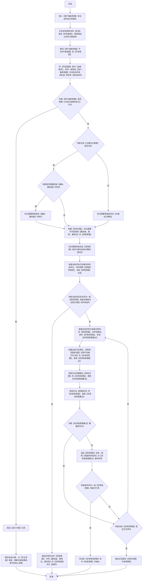

### 思路设计逻辑流程图（**必须严格按照顺序执行，逐个节点执行，从开始到结束**）

### 关键定义和解释(**必须严格遵守**)
 1. 【目标问题】：【目标问题】指诉求、边界与验收口径均已写明、仅解决路径待定的课题本体。
 2. 【实体】与【实体类型】：【实体】指【目标问题】范围内可以单独指称、可以单独追问的对象；【实体类型】指该对象归属的类别；【关联结构】指实体之间、实体类型之间存在的连接、层级与依赖关系，三者共同决定一条路径改动后会牵动哪些对象。
 3. 【工程化或者体系化】：【用户最新意图】存在工程化建设或体系化建设的含义；或者存在多个【设计需求】；或者还未设计【核心概念或体现架构】就需要交付成果；**若【用户最新意图】为纯研究讨论，则可自主视情况而定**。
 4. 【关键设计要素】：至少包含以下几类：
    - a.【目标问题】涉及的对象和关系结构；
    - b. 每个专业名词或专业术语的定义和解释；
    - c. 权威材料（如：技术、规范、标准、兼容性等）；
    - d. 【目标问题】涉及的所有【常规场景】和【非常规场景】。
 5. 【思路研究规则】：至少包含以下规则：
    - a. 对所有已知思路可行性研究并获取【可行性结论】。
    - b. 具备【可行性】的思路必须互相交叉对比【优缺点】。
    - c. 必须分析每个思路能够解决哪些问题，解决了哪些【痛点和难点】。
