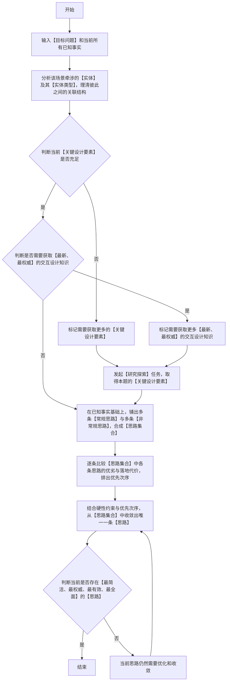

### 适用
 适用于目标问题、边界与验收口径都已写明、但解决路径尚未确定的产品或项目：需要先发散多条常规思路与多条非常规思路，逐条比较优势与代价后收敛为唯一设计思路，并给出该思路的成立依据；任务类型取【研究探索】或【设计方案】，交付类型取【权威结论】或【方案】；解决路径已定、只待展开实施步骤时，不走本技能。

### 思路设计逻辑流程图（**必须严格按照顺序执行，逐个节点执行，从开始到结束**）

### 关键定义和解释(**必须严格遵守**)
 1. 【目标问题】与【已知事实】：【目标问题】指诉求、边界与验收口径均已写明、仅解决路径待定的问题本体。
 2. 【实体】与【实体类型】：【实体】指【目标问题】范围内可以单独指称、可以单独追问的对象；【实体类型】指该对象归属的类别；【关联结构】指实体之间、实体类型之间存在的连接、层级与依赖关系，三者共同决定一条路径改动后会牵动哪些对象。
 3. 【关键设计要素】：至少包含以下几类：
    - a. 时间、成本、人力、权限等。
    - b. 技术、规范、标准、兼容性等。
    - c. 依据【目标问题】所属的【专业领域】与业务类型，当前已知的不可逾越的边界与红线。
 4. 【常规思路】与【非常规思路】：【常规思路】指贴合【已知事实】与已有成功经验的路径；【非常规思路】指脱离既有经验、由【已知事实】发散得到的未验证路径；两类路径合并构成【思路集合】，其中每条路径都要写清自身的【优势】与【劣势】，未写清者视为未完成比较。
