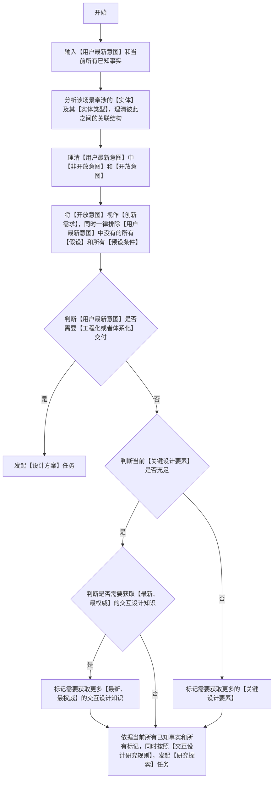

### 交互设计逻辑流程图（**必须严格按照顺序执行，逐个节点执行，从开始到结束**）

### 关键定义和解释(**必须严格遵守**)
 1. 【实体】与【实体类型】：【实体】指本场景中用户可辨认并直接操作的对象（如账号、单据、消息、设备、会话）；【实体类型】指这些对象所属的类别；两者的关联结构决定界面上谁能打开谁的详情、谁依附谁存在、谁被谁引用、删掉谁会连带影响谁。
 2. 【关键设计要素】：至少覆盖下列三类内容，并受既有界面现状、平台交互惯例、无障碍与性能等不可让步的约束：
    - a. 操作任务清单：用户为达成目标必须完成的动作、先后次序，以及每个动作的触发入口。
    - b. 状态全集与状态迁移：界面每一步呈现什么状态（空态、加载态、正常态、错误态、无权限态），可以进入哪些下一步，失败后如何回退。
    - c. 即时反馈与异常恢复：每个动作的可见响应与耗时预期，以及报错、超时、断网、中断之后的重试、撤回或补偿方式。
 3. 【交互设计研究规则】：
    - a. 若设计的目标对象为系统，则需要了解该系统的操作流程，使用此系统的有哪些使用者以及这些使用者的具体身份。
    - b. 需要了解【设计的目标对象】涉及的【专业领域】和【业务类型】。
    - c. 需要依据【设计的目标对象】涉及的【专业领域】，进一步了解常规【视觉设计/交互逻辑设计】惯例和【必须注意的细节】。
    - d. 若具备互联网访问条件，可进一步了解与当前【设计的目标对象】的【专业领域】相关的，并且是【最新、最权威】的多个【交互设计案例】；用于分析和比较。