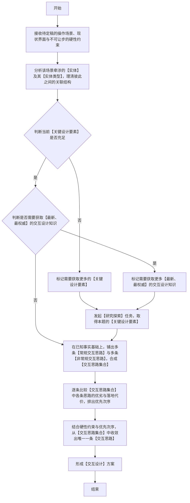

### 适用
 适用于操作行为尚未定稿的界面或系统：需要把用户要走的操作序列、状态迁移、即时反馈与异常恢复逐条定死；任务类型取【设计方案】或【执行落地】，交付类型取【详细规划】或【文件链接】；只差配色、排版、图标与视觉素材时，不走本技能。

### 交互设计逻辑流程图（**必须严格按照顺序执行，逐个节点执行，从开始到结束**）

### 关键定义和解释(**必须严格遵守**)
 1. 【实体】与【实体类型】：【实体】指本场景中用户可辨认并直接操作的对象（如账号、单据、消息、设备、会话）；【实体类型】指这些对象所属的类别；两者的关联结构决定界面上谁能打开谁的详情、谁依附谁存在、谁被谁引用、删掉谁会连带影响谁。
 2. 【关键设计要素】：至少覆盖下列三类内容，并受既有界面现状、平台交互惯例、无障碍与性能等不可让步的约束：
    - a. 操作任务清单：用户为达成目标必须完成的动作、先后次序，以及每个动作的触发入口。
    - b. 状态全集与状态迁移：界面每一步呈现什么状态（空态、加载态、正常态、错误态、无权限态），可以进入哪些下一步，失败后如何回退。
    - c. 即时反馈与异常恢复：每个动作的可见响应与耗时预期，以及报错、超时、断网、中断之后的重试、撤回或补偿方式。
 3. 【常规交互思路】与【非常规交互思路】：【常规交互思路】沿用成熟产品已经跑通的既有操作范式与被验证过的交互经验，步数与风险都可以预估，适合作为基线先把主流程跑通；【非常规交互思路】跳出既有操作范式，改用尚无成功先例的交互形态来承载同一任务，收益与风险都需要另行论证，只有在常规思路撑不住硬性约束时才优先考虑。
 4. 【交互思路集合】与【交互思路】：【交互思路集合】是全部候选思路的汇总，收敛之前每条都保持可比较、可淘汰；【交互思路】是从该集合里收敛出的唯一一条待落地思路，须同时满足操作任务清单、状态迁移与全部硬性约束，并能逐条回答这一步用户是否看得懂、点得到、退得回。
