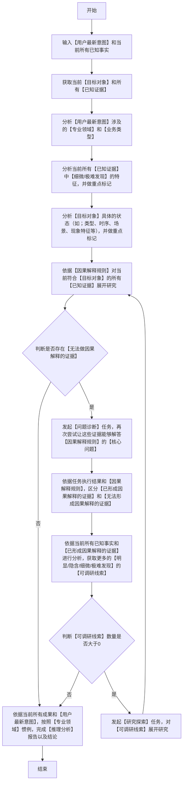

### 推理分析逻辑流程图（**必须严格按照顺序执行，逐个节点执行，从开始到结束**）

### 关键定义和解释(**必须严格遵守**)
1. 【因果解释规则】：是否可以形成因果解释，其实是围绕着一个核心问题展开的：
   - 核心问题：**在【目标对象】的【已知状态】下，当前【已知证据】是由于什么【原因】而存在？**
   - 若依据当前所有已知事实，存在一个或多个【已知证据】能够得到此【核心问题】的解答，且解答【逻辑闭环】，则这些【已知证据】视作【已形成因果解释】；反之，若一个或多个【已知证据】无法解答此【核心问题】或者解答【逻辑无法闭环】，则这些【已知证据】视作【无法形成因果解释】。

### 推理分析原则（**【推理分析逻辑流程图】核心过程 **）
 1. **推论产生**：依据当前所有已知【场景】和所有【已知证据】和所有【已证实的推论】，推断并得出【产生】当前现象的所有【因素】，且这些【因素】当前只能标记为【经过推测得出】，并且（推断【产生】当前现象的所有【因素】）的这个行为，统称为【推论】，必须进行【推论证明】才具备（去掉【经过推测得出】标记并当成事实）的条件。
 2. **证据查找**：需尽可能的查找，为【推论证明】提供关键证据。
 3. **推论证明**：根据当前已知的【实际证据】，经过用当前已知的【公理和定理】用【最严密、最专业、最权威】的闭环推导，证明：
    - a. 若**推论中存在唯一【因素】**，并且存在证据能够证明**产生当前现象的唯一可能性是【推论】中的因素，则此【推论】成立**；
    - b. 【推论】中指定的现象与推断的所有【因素】，呈现（果即【现象】）（因即【因素】）关系，则此【推论】成立；反之并且不符合【a条件】，则此【推论】不成立。
    - **不成立的【推论】分两种，证明结果中必须有【明确标记】：a.当前没有足够的证据使得【推导过程】闭环。2.存在任何一个【证据】直接证明【推论】不成立并且【推导过程】已闭环**
 4. **迭代分析**：经过推论证明的【推论】标记为【已证实的推论】并去掉【经过推测得出】标记，同时作为下一个迭代【推论产生】的材料。
 5. **迭代停止条件**：完成【用户最新意图】的所有要求或当前已无可继续调研的线索且无法迭代，则视作【推论分析】完成，给出【最专业、最严谨】的报告。

  