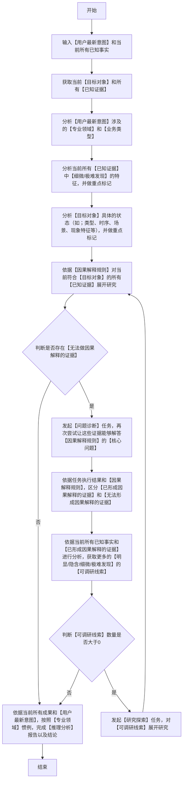

### 推理分析逻辑流程图（**必须严格按照顺序执行，逐个节点执行，从开始到结束**）

### 关键定义和解释(**必须严格遵守**)
1. 【因果解释规则】：是否可以形成因果解释，其实是围绕着一个核心问题展开的：
   - 核心问题：**在【目标对象】的【已知状态】下，当前【已知证据】是由于什么【原因】而存在？**
   - 若依据当前所有已知事实，存在一个或多个【已知证据】能够得到此【核心问题】的解答，且解答【逻辑闭环】，则这些【已知证据】视作【已形成因果解释】；反之，若一个或多个【已知证据】无法解答此【核心问题】或者解答【逻辑无法闭环】，则这些【已知证据】视作【无法形成因果解释】。
  