### 适用
可变更产物的新增、修改、修复、重构、优化，以及实际改动闭环

### 执行变更流程图（**必须严格按照顺序执行，逐个节点执行，从开始到结束**）

```mermaid
flowchart TD
START[开始] --> A[输入【执行变更】任务完整具体的信息]
A --> B[分析并提取所有的【明显/隐含/细微/极难发现】的变更特征，形成【变更点集合】]
B --> C[分析【变更点集合】中每个【变更点】涉及的【专业领域】，并尝试查找【权威】的专业知识进行【学习】]
C --> C1[判断是否可访问【互联网】]
C1 -- 是 --> C2[尝试查找【最新、最权威】的专业知识进行【学习】]
C1 -- 否 --> D[调用可用工具，系统性查找【可参考材料】具体位置，并制作成【参考资料索引】]
C2 --> D
D --> E[分析【变更点集合】的每个【变更方式】以及涉及的【实体类型】]
E --> E1[依据每个【变更点】的【变更方式】以及【参考资料索引】，按照【参考材料适用规则】筛选材料并展开详细调研]
E1 --> F[系统性分析每个【实体类型】之间的关系结构以及其他各类【关键要素】]
F --> G[为每个【变更点】所在的【变更范围】，构建【变更逻辑】并形成【逻辑二叉树】]
G --> H{系统性分析并判断是否存在【遗漏】的【关联变更】}
H -- 是 --> B
H -- 否 --> I[依据所有已知事实，构建【最小变更策略】并提取所有的【执行决策】构建【决策树】]
I --> I1[依据当前所有已知事实，按【变更策略优化规则】优化并完善【最小变更策略】以及【决策树】]
I1 --> J{判断当前【最小变更策略】是否能够完成所有【变更目标】}
J -- 是 --> K{判断当前【最小变更策略】是否存在【过度执行】或【越界变更】或【变更冲突】}
J -- 否 --> I
K -- 是 --> I
K -- 否 --> L{判断当前【最小变更策略】是否【副作用最低】}
L -- 是 --> M[搜索当前环境下，适配当前变更且用于【语法核验】或者【规范核验】的独立工具或程序]
L -- 否 --> I
M --> M1[搜索当前环境下，适配当前变更的【版本管理】独立工具或程序]
M1 --> N[将【最小变更策略】存入【临时文件】，便于之后回溯和核查]
N --> N1[开启事务模式并依据【变更对象】执行备份]
N1 --> O[依据【最小变更策略】，采用【逐步推进】的方式【执行】直到执行完成]
O --> P{判断【逐步推进】的执行【最小变更策略】过程中，是否存在【无法修复】的执行失败步骤}
P -- 否 --> P1{获取所有【变更差异】并回溯【最小变更策略】，判断是否存在【越界执行】的情况}
P1 -- 是 --> Q[发起事务回滚并还原所有变更内容,重新开始执行]
Q --> N
P1 -- 否 --> R[依据当前已知事实和【变更差异】，核查所有【关联链路】和【数据流】，系统性找到【细微/极难发现/隐含】的特征并作【重点标记】]
R --> S[生成一个假设性结论X:当前已完整实现所有【变更目标】，并且【逻辑自洽】以及【数据流闭环】]
S --> T[尽最大努力查找【可推翻】结论X的证据]
T --> U{判断是否存在【可推翻】记录X的证据}
U -- 是 --> U1[结论X被推翻，同时已证明了当前变更必然存在【遗漏】必须进行补充和完善]
U1 --> M
U1 -- 否 --> V[按照【变更核验规范】进行【核验】]
V --> W{判断是否【核验通过】}
W -- 否 -->Y[输出变更失败并说明详细原因，发起事务回滚并还原所有变更内容]
W -- 是 -->X[输出执行变更成功和所有【变更差异】等内容]
P -- 是 --> Y
X --> Z[退出事务模式，并清理临时文件和无需保留的（bak/backup）等备份]
Y --> Z
Z --> END[结束]
```

### 附加变更执行规则
 - 1.执行某个步骤失败，则优先排查执行操作是否出错并进行修复。
 - 2.绝对禁止任何占位性变更或者无实际意义的行为。

### 关键定义和解释
1. 【可参考材料】：是指与当前任意【变更点】关联的【架构】、【核心概念】、【文档】、【可复用对象或组件】等信息。
2. 【参考资料索引】：实际落地用于存储【可参考材料】的位置信息，json格式，是一个【临时文件】当前整体任务结束之后可删除。
3. 【参考材料适用规则】：每个【变更点】依据（重构/新增/修改/删除）变更方式适用不同规则，以下分点说明：
    **核心原则：只能选择与【变更点】内【实体类型】有【明显/隐含】关联的参考材料做详细的【内容分析】**
    - a. 若变更方式为【重构】，则**绝不参考**属于该【变更点】范围内的所有【参考材料】。
    - b. 若变更方式为【新增】或【修改】，则**必须参考**符合【核心原则】的【参考材料】。
    - c. 若变更方式为【删除】，则可以参考【文档】用于明确【删除规范】，剩余其他材料**绝不参考**。
4. 【关联变更】：是指在受当前执行变更影响的【逻辑链路】和【数据链路】中，为确保链路闭环与完整而必须同步修改的节点。
5. 【变更方式】：通常指（重构/新增/修改/删除）等，一个【大致变更范围】只有一种【变更方式】。
6. 【变更策略优化规则】：必须按照以下规则完善并优化：
   - a. 若任务无特殊要求，则【最小变更策略】必须依据符合【专业领域】的【常规做法、习惯、关键点】作为【制定方向】。
   - b. 若依据【专业领域】的【常规做法、习惯】行不通，则可在了解【专业知识】的基础上用【非常规思路】去制定【最小变更策略】。
   - c. 【最小变更策略】无论任何情况下都必须保持【逻辑闭环】；且优化方向为【最专业、风险最低、最鲁棒】。
7. 【变更冲突】：是指【变更内容】影响到了与当前【执行变更】任务无关的部分。
8. 【越界变更】：是指【最小变更策略】中存在至少一个不符合【变更目标】的行为；目的是避免改掉不该改的东西。
9. 【变更核验规范】：按顺序至少执行以下四个步骤：
    - a. 【语法核验】: 必须调用可用工具，至少使用代码语法检查工具，检查当前变更是否产生报错信息。
    - b. 【静态核验】: 必须调用可用工具，至少检查是否符合任务约束以及是否存在一些**极难发现的错误的变更差异**。
    - c. 【生效核验】: 必须调用可用工具，依据方案中的【验收方法】进行核验，同时依据【变更对象】全链路检查【变更目标】是否已【完全闭环】实现并且没有任何【遗漏】。
    - d. 【逻辑核验】: 必须调用可用工具，至少检查是否存在【占位性逻辑】、逻辑合理性（重点看主次关系、时序关系等）、逻辑闭环性。

10. 【变更差异】：若git工具可用且是文本文件类型变更，则用当前文件(已变更状态)和备份文件(未变更状态)比对生成diff，需注意顺序。
11. 【副作用】：与当前任务无关，但深度交叉分析出现一些：【风险点、BUG、死锁、视觉问题、用户体验差、操作复杂度变高、信息重复、语义混乱】等其他类似情况都是副作用。

### 附加全局约束
1. 【执行变更流程图】已为【最优、最简便、最权威】的处理逻辑，禁止其他任何优化处理操作。
2. 任何情况下都必须严格按照【执行变更流程图】从【开始】至【结束】，必须按【节点】顺序逐个执行，任何中断、跳过、重排、合并、改名等优化【流程节点】的行为，无论任何理由一律视作【致命错误】。
3. 交付物为【文件链接】时，URL 核验逻辑必须改用文件是否存在核验逻辑替代；因为URL 由外层组装，故必须采用此方式。
4. 查找材料的过程中，需要重点关注输入和输出具体的值、生产和消费链路、时间线、约束和规范、组织结构、触发条件、判断逻辑等；并且调研分析不能只停留在表层特征（如：字段名、变量名），必须做深度挖掘或溯源。
5. 若当前执行变更任务已完成但存在不符合【任务约束】的变更，则必须视作失败，回滚事务至未变更状态。
6. 【特征比对和确认】：若只比对表层含义或者标识，一律视作【严重错误】，这是因为这种比对必然出现【张冠李戴】的结果，必须比对每个核心要素和每个细节才能确认。
7. 在设计【最小变更策略】前，调研相关资料务必先对资料做有【事实依据】的彻底分类和【权威性打分】，目的是：避免对资料理解出现偏差从而出现【幻觉现象】。
8. **若变更对象相关环境下，存在并实际使用了【版本管理】工具，则(bak/backup)等备份视作【无需保留】**。
9. 调研过程中，尽可能鉴别【幽灵信息】，因为【幽灵信息】会引导至错误的执行结果。
10. 变更方式为【重构】可以不必顾及与【旧内容】冲突，**但【重构】必须【谨慎】并且完全符合【任务要求】，同时在【任务约束】的范围之内**。
11. **按【最小变更策略】执行时，若遇到【可修复】的执行失败，则直接修复，不影响正常流程**。

### 附加输出要求
1. 必须记录并输出按【执行变更流程图】实际执行的【流程节点链路】。
2. 必须输出【执行概要】、【已执行变更项】。
3. 必须输出【完整核验过程】。
4. 必须输出每个【变更对象】的每个【变更差异】。
5. 必须输出每个【判断节点】的分析过程。

