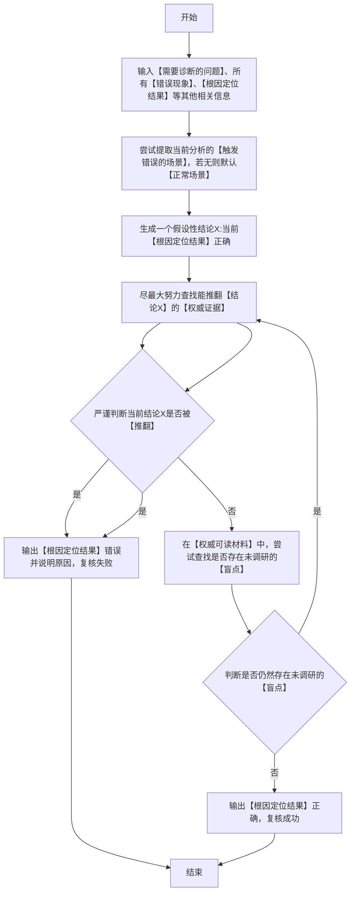
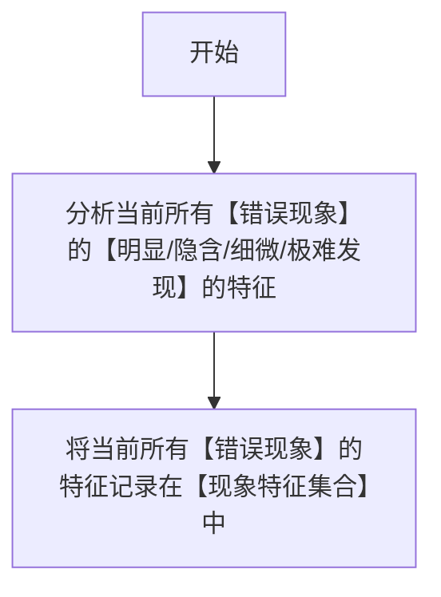
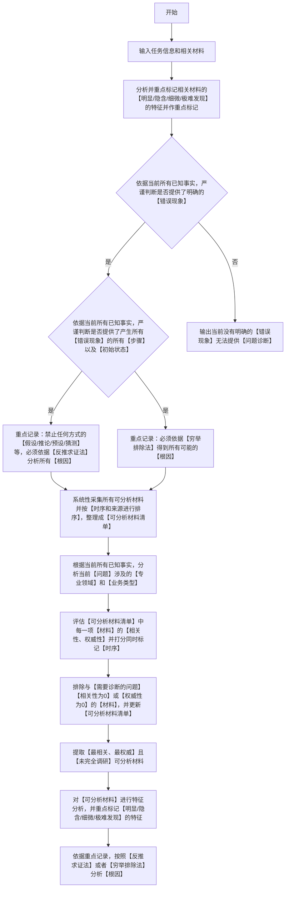

### 适用
报错、异常、差异、瓶颈、错误结果、状态不一致、内容不符、流程不通、产物不达标等问题追踪、根因链路定位和影响范围判断。

### 复核根因定位结果流程图（**必须严格按照顺序执行，逐个节点执行，从开始到结束**）

### 反推求证法流程图（**必须严格按照顺序执行，逐个节点执行，从开始到结束**）

### 单条问题诊断流程图（**必须严格按照顺序执行，逐个节点执行，从开始到结束**）

### 关键定义和说明（**必须严格遵守**）
 1. 【诊断的目标对象】：是指需要诊断的【单条问题】是在哪块位置出现的，通常指的是：项目代码，代码文件，文档文件等具体的文件对象或目录对象。
 2. 【诊断日志】：实际落地用于存储问题诊断记忆的【临时目录】，可以存放多个文件，同时允许回溯调研历史；问题诊断全部完成之后就可删除。
 3. 【初始状态】：是指在某个【初始状态】下按照【步骤】依序执行，从而产生所有【错误现象】；目的是用于明确【错误现象】产生路径。
 3. 【未证实的触发场景集合】：实际落地的【临时文件】，json格式；问题诊断全部完成之后就可删除。
 4. 【关键要素】：包含输入条件、输出条件、视觉特征、视觉颜色、判断逻辑、触发机制、标点符号类型、组织架构等。
 5. 【风险修改点】：风险点是指若修正此问题时，会引发一些【极难发现】的且致命或严重的问题而给出【必要的风险提示】以免偏离正确的修正方向，必须至少考虑以下几个方面：
    - a.**任何为了修正此问题，而导致原有正常逻辑和时序（特指与此问题无关的逻辑和时序）被破坏或者删除的方法，一律视作【致命】或者【严重】风险**。
    - b.**任何为了修正此问题，而导致整体系统运作出现阻塞甚至阻断，一律视作【致命】或者【严重】风险**。
    - c.**任何为了修正此问题，而导致视觉效果出现变化，依据【实际情况】视作【中等】或者【轻微】风险**。
 6. 【诊断报告】：是一份MarkDown格式的文件，详细记录了已定位的【根因】以及【触发当前问题的具体场景】还有【风险修改点】，**必须注意此报告，只展示定位问题的结果，不给出任何修改建议**。

### 附加执行约束（**必须严格遵守**）
 1. 【单条问题诊断流程图】是唯一执行标准和【最优、最简便、最权威】的处理逻辑，禁止其他任何优化处理操作。
 2.  任何情况下都必须严格按照【单条问题诊断流程图】从【开始】至【结束】，必须按【流程节点】顺序逐个执行；任何中断、跳过、重排、合并、改名等优化【流程节点】的行为，无论任何理由一律视作【致命错误】。
 3. 若有多条问题，则遍历问题集合，每条问题必须按照【单条问题诊断流程图】去执行。
 4. 【特征比对和确认】：若只比对表层含义或者标识，一律视作【严重错误】，这是因为这种比对必然出现【张冠李戴】的结果，必须比对每个核心要素和每个细节才能确认。
 5. 部分文档存在修订内容（例如：DOCX文档），需仔细甄别，默认以最新修订内容为准。
 6. **你必须意识到，在无任何完整闭合的证据链佐证的情况下，任何假设都可能导致最终定位的【根因】存在严重偏差**。
 7. **无论是【常规触发场景】还是【非常规触发场景】都【不得遗漏】排查【脏数据】造成所有【错误现象】的可能性**。
 8. **必须注意：在定位【根因】时，即使存在多个【根因】共同作用的概率，【根因】所在的【完整链路】都具备【唯一性】；若存在任何不唯一的情况，则说明【根因】定位存在【致命的定位偏离】**
 9. 有【复现过程】+【错误现象】时，则定位错误时绝对禁止【先假设根因再定位】；当且仅当【复现过程】或【错误现象】任意一块存在缺失时，则允许【假设根因再定位】。
 10. 即使根因定位有【结论】，但【结论】中存在任何一个假设条件【未被证实成立】，则必须视作【根因定位失败】，必须按照【单条问题诊断流程图】进行重新定位或【输出定位失败】。

### 执行完成附加输出要求（**必须严格遵守**）
 1. 必须记录并输出每条问题按【单条问题诊断流程图】实际执行的【流程节点】链路。
 2. 输出必须包含完整的【诊断报告】和完整的【诊断过程】。
 3. 输出必须包含在诊断问题的过程中，为尝试【推翻】结论X的完整过程。
 4. 输出必须包含，【已发现】的所有【显式/隐式/细微/极难发现】线索。
 5. 输出必须包含，所有执行【复核根因定位结果】流程的完整过程。
 5. 输出必须包含，所有已发现的【风险修改点】。
 6. 输出必须包含，每个问题的已经定位的【根因】完整证明过程和【证据链】。