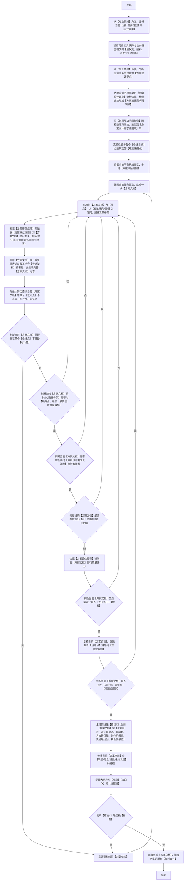

### 适用
 统筹规划、制作详细规划、统筹规划、设计方案、制作方案文档

### 方案设计逻辑流程图（**必须严格按照顺序执行，逐个节点执行，从开始到结束**）

### 关键定义和说明（**必须严格遵守**）
 1. 【设计任务类型】：分为(全创新设计/适应性设计/变形设计/全封闭设计)等类型，目的是准确识别【当前设计任务】所需的【创新程度】。
 2. 【方案设计要求】：根据任务信息分析，至少按以下规则去分析(a~h)（**按因果关系句式表述分析结果，例如：依据...分析得到...**）：
    - a.分析任务信息中包含哪些【实体】，有哪些【实体类型】，每个【实体类型】有哪些特性。
    - b.分析任务信息中有哪些【环境要求】和【场景要求】等信息。
    - c.分析当前任务有哪些设计目标和每个设计目标的【子项以及要求】。
    - d.分析【每个设计目标】，具体的设计方式（例如：全新构建，按已有规范构建，创新构建，重构，修改完善，删除清理,等等）。
    - e.分析【每个设计目标】，有哪些【子项】适用同一个类型的【设计规范】？有哪些【子项】较为特殊，不能适用同一种类型的【设计规范】？。
    - f.分析需要【构建或使用】哪些【明显/隐含/细微/极难发现】设计规范？哪些设计规范需要【统一化】？哪些设计规范存在【特殊细节】？
    - g.从【专业领域】的角度分析，分析哪些设计会对【当前需要产出的方案】起到【正向收益】？哪些设计会对方案起到【负向收益】？
    - h.分析当前方案有哪些【参与对象】？有哪些【观察对象】？
 3. 【方案设计需求说明书】：用于存储方案设计需求说明，是一个【临时文件】；同时**禁止自行编造任何需求**，每一个需求项都必须有所依据。
 4. 【必须解决问题集合】：若不解决这些问题，则当前方案就不具备【可行性】或者【不符合任务要求】，是一个【临时文件】。
 5. 【难点或痛点】：是指必须攻克的关键障碍或者即使使用最新、最权威的方法，仍然存在的缺陷和问题（如：技术障碍、规则冲突、效率性缺陷、误判或卡顿、资源上限等）。
 6. 【方案评估规则】：在方案完全可行的基础上，从【专业领域】角度形成的评估方案设计质量的规则，是一个【临时文件】；
    - 评估规则中，对方案质量评分至少存在以下等级分区（零分/不合格/合格/良好/优秀/满分）。
    - ** 方案质量总分计算公式:$W=\frac{\left(A\cdot e^{-B/5.00}\right)\cdot\left(C/5.00+1.00\right)+D}{e^{T}}$ ;W最大值为【满分】;W最小值为【零分】 **
    - **方案质量总分计算公式参数说明**：
      - A:评估方案是否符合设计需求(0.00~5.00分，可有两位小数)
      - B:评估方案每个设计的平均复杂度(0.00~5.00分，可有两位小数)
      - C:评估方案解决【难点和痛点】的实际程度(0.00~5.00分，可有两位小数)
      - D:评估方案符合【设计规范】的实际程度(0.00~5.00分，可有两位小数)
      - E:评估方案带来的【设计风险】(0.00~5.00分，可有两位小数)
 7. 【方案文档】：方案设计正式文档，默认为MarkDown格式，必须整洁且无任何冗余表述，用于流程图走到【结束】之后，最终交付。
 8. 【发散研究规则】：在严格围绕着【方案设计目标】要求的情况下，展开发散式设计，必须严格按一下规则进行发散：
     - a.尽最大努力去思考更多【难点或痛点】的解决方案。
     - b.尽最大努力去发现方案的【明显/隐含/细微/极难发现】的盲点，并做重点标记。
     - c.尽最大努力去避免方案出现【非轻微风险点】，并完善方案设计。
     - d.尽最大努力去完善方案的叙事逻辑，并形成自洽并且【唯一】的核心叙事逻辑。
 9. 【方案收敛规则】：在先前进行发散研究之后，需要进行【收敛和归纳】，必须严格按以下规则顺序进行逐步收敛（**必须注意，每个迭代都必须从【a步骤】逐步执行到【h步骤】，不能有任何跳过行为**）：
     - a. 将方案收敛为只有一个【核心概念】，只能围绕着这一个【核心概念】进行叙事。
     - b. 【尽最大努力】剪除【方案】中，任何存在【过度设计】、【重复设计】以及【越界设计】的内容。
     - c. 检查并补充【方案】中每一处【极难发现的缺口】或者【隐含缺口】。
     - d. 确保方案核心叙事逻辑自洽，同时剪除环路之外的【过度设计】和【越界设计】。
     - e. 剪除【方案】中，无法形成【逻辑自洽】或者【存在证据链缺口】的内容，并再次整理内容确保【逻辑自洽】和【证据链完整】。
     - f. 补充【方案】中，每一项内容的具体可实际落地的实施步骤。
     - g. 在确保方案【关键要素】、【核心优点】不变的情况下，尝试使得方案更【简洁化、专业化】。
     - h. 整理【方案】表述，使得更直观、更权威、更专业，并使得方案整体内容完整性达到【开箱即用】的标准。
 10. 【副作用】：与当前任务无关，但深度交叉分析出现一些：【风险点、BUG、死锁、视觉问题、用户体验差、操作复杂度变高、信息重复、语义混乱】等其他类似情况都是副作用。

# 资料查找约束(**必须严格遵守**)
 1. 任何情况下，以任何方式查找任何资料都务必去标记每段资料的【具体时间、具体来源、具体类型】；否则在使用资料时就会造成严重【幻觉】。
 2. 任何情况下，但凡发现任何URL类型的信息都必须去识别，若为网页、图片、文档都务必进一步获取内容。
 3. 若网页或文档（例如：DOCX文档,PDF文档等）中包含【有效图片】也必须去识别内容特征，以免遗漏任何特征，导致出现【幻觉】或者【错误】理解。
 4. 若发现【有效图片】也绝不能遗漏去识别内容特征。
 5. 必须重视那些【细微特征】以及特征直接浮现的【隐含线索】，这有助于你能全面的理解资料。
 6. 若调研链路，则必须专注区分【幽灵链路】和【非幽灵链路】，从而避免对链路的逻辑理解出现严重错误。
 7. 部分文档存在修订内容（例如：DOCX文档,XLS文档等），需仔细甄别，默认以最新修订内容为准。
 8. 【特征比对和确认】：若只比对表层含义或者标识，一律视作【严重错误】，这是因为这种比对必然出现【张冠李戴】的结果，必须比对每个核心要素和每个细节才能确认。

### 执行完成附加执行约束(**必须严格遵守**)
 1. 方案设计必须以【方案设计逻辑流程图】为【唯一执行标准】。
 2. 【方案设计逻辑流程图】已为【最优、最简便、最权威】的处理逻辑，绝对禁止其他任何优化处理操作。
 **【方案设计逻辑流程图】每个节点设计都存在极高价值，必须逐个节点走完，方案设计任务本就耗时，绝对不得为了节省时间而不按【方案设计逻辑流程图】逐个节点执行**
 3. 任何情况下都必须严格按照【方案设计逻辑流程图】从【开始】至【结束】，必须按顺序逐依执行【流程节点】；任何中断、跳过、重排、合并、改名等优化【流程节点】的行为，无论任何理由一律视作【致命错误】。
 4. **方案设计中必须重视文字表述风格，默认必须符合【专业领域】的文字表述风格，并且【相同类型场景】下的文字表述风格必须完全统一**
    - **特别注意：必须仅在符合需要做【说明】的【设计点】下，用【对应类型】的说明性文字；其他情况，一律不允许使用任何类型的说明文字**
    - **特别注意：未经授权允许的情况下，禁止在任何地方写更改说明或者更改日志**

 5. 【方案文档】最终必须【证据链完整】且【不偏离当前设计要求】。
 6.  方案设计的核心目标是：**产出的【方案文档】必须是逻辑自洽、设计最简洁、最精妙、方法最可靠、副作用最低、表述最恰当、耦合度最低**，**无论迭代多少次也要达成这个目标**。
 7. 【核心问题】除了明显的问题之外，还必须注意基于事实基础浮现出的【隐含的问题】。
    - **若依据所有权威性证据仍然无法分析并获得解决核心问题的正确方法，则可用现有权威性证据为【原点】，【发散式思考】并完整构建符合实际专业逻辑的【创造性】解决方法**
 8. 输出的【方案文档】务必确保无任何指代性表述，完整性【开箱即用】，具备可立刻实施的条件。
 9. **若当前方案设计是属于执行计划类型，则必须包含【验收方式】章节（其他类型按实际情况酌情处理），并且必须详细、细致的说明【如何验收每个方案设计点】**

### 附加输出要求(**必须严格遵守**)
 1. 输出必须包含【方案设计逻辑流程图】实际执行的【流程节点链路】。
 2. 输出必须包含所有的【方案设计要求】。
 3. 输出必须包含【方案评估规则】具体依据。
 3. 输出必须包含【方案文档】的实际【质量评分】。
 4. 输出必须包含方案每次迭代过程中，方案按【发散规则】进行【发散设计】的完整过程。
 5. 输出必须包含方案每次迭代过程中，方案按【方案收敛规则】进行【逐步、逐项收敛】的完整过程。
 6. 输出必须包含【方案文档】中可解决的具体【难点和痛点】的方法介绍。
 7. 输出必须包含【方案文档】的【优点】、【缺点】以及【副作用】介绍。
 8. 输出必须包含【方案文档】的设计是【逻辑自洽、设计最简洁、最精妙、方法最可靠、副作用最低、表述最恰当、耦合度最低】的证明过程。