### 适用
按已确认的需求、变更、接口、流程、风险、缺陷、验收口径或既有材料编写可执行测试用例

### 编写用例流程图（**必须严格按照顺序执行，逐个节点执行，从开始到结束,绝对不准违反任何规则**）

```mermaid
flowchart TD
START[开始] --> A[输入所有任务信息]
A --> B[依据任务信息，提取所有【测试对象】、所有【测试目标和测试方式】和所有【测试范围】]
B --> C{调用可用工具，判断是否可以获取符合任何一个【测试目标】的【用例编写材料】}
C -- 是 --> D[记录具备【白盒测试】条件]
D --> D1[分析当前【测试对象】涉及的【实体类型】以及【实体类型】之间的【明显/隐含/细微/极难发现】关系特征]
D1 --> E[分析【用例编写材料】中【明显/隐含/细微/极难发现】的特征以及【关键要素】]
E --> E1[系统性分析符合所有【测试范围】和所有【测试方式】的所有【可操作项】、所有【可实验项】以及所有【可观察项】]
E1 --> F{调用可用工具，判断是否存在可观察【测试目标】业务逻辑的【用例编写材料】}
F -- 是 --> F1[分析每个【测试目标】业务逻辑的原子级【流程类型】以及【明显/隐含/细微/极难发现】的【决策点】]
F1 --> F2[依据当前所有已知事实，尽最大努力构建每个【测试目标】的准确【业务逻辑流程图】]
C -- 否 --> G[记录只具备【黑盒测试】条件]
G --> G1[依据当前已知事实，分析当前测试涉及的【专业领域】和【业务类型】]
G1 --> G2[调研并记录【黑盒测试】下所有【可操作项】和所有【可实验项】]
G2 --> G3[分析并记录符合【测试目标】和【测试范围】的基线【测试场景】]
F2 --> G3
F -- 否 --> G3
G3 --> H[将当前所有已知事实和【用例编写材料】的调研结果，记录在【调研笔记】中]
H --> I[以基线【测试场景】为原点，以【专业领域】和【业务类型】为方向，发散式调研所有常规【测试场景】]
I --> I1{判断编写用例要求是否需要包含【复杂,叠加,交叉】的【测试场景】或非常规【测试场景】}
I1 -- 是 --> I2[已当前所有已知的常规【测试场景】为原点，发散式调研所有【复杂,叠加,交叉】的【测试场景】或非常规【测试场景】] 
I1 -- 否 --> J{判断当前【测试场景】调研是否超过【测试范围】边界}
I2 --> J
J -- 否 --> J1[发散式调研程度不足，继续]
J1 --> I
J -- 是 --> K[排除不符合【测试范围】以及【无有效性】的【测试场景】]
K --> K1[将剩余已调研的所有【测试场景】记录在【调研笔记】中]
K1 --> L[按【测试场景】和【测试目标】分组，结合每个场景对应的【可操作项】和【可实验项】，分别构建【业务操作流程图】，并记录在【调研笔记】中]
L --> L1{结合当前【编写用例要求】判断是否需要包含【异常操作】或【并发操作】}
L1 -- 是 --> L2[结合所有可能【异常操作】或【并发操作】，修订并完善所有【业务操作流程图】]
L1 -- 否 --> M{判断每个【业务操作流程图】是否存在下游分支数 >2 的【流程节点】}
L2 --> M
M -- 是 --> M1[【业务操作流程图】拓扑深度不足，同时需进一步完善细节]
M1 --> L
M -- 否 --> N[创建或更新【测试用例文档】]
N --> O[获取一个未完成编写用例的【业务操作流程图】]
O --> O1[依据当前所有已知事实和【调研笔记】，以【业务操作流程图】为【基线】编写测试用例，并记录到【测试用例文档】中]
O1 --> P{判断是否还存在未完成编写用例的【业务操作流程图】}
P -- 是 --> O
P -- 否 --> Q[依据【用例细节规范】完善【测试用例文档】每个【测试用例】]
Q --> R[排除不符合【用例筛选规则】的【测试用例】，并更新【测试用例文档】]
R --> S[生成假设性【结论X】:当前【测试用例文档】至少覆盖了所有【测试目标】【常规场景】和【常规操作流程】，用例设计的细节度覆盖了所有【测试盲点】]
S --> T[尽最大努力查找【推翻】【结论X】的证据]
T --> U{判断【结论X】是否被推翻}
U -- 是 --> V[授权可在【测试用例文档】进行【新增/修改/删除/合并/拆分】【测试用例】，并进入下一个迭代]
V --> N
U -- 否 --> W{复核并判断当前【测试用例文档】是否覆盖所有【测试目标】，所有【测试对象】并且准确符合【测试范围】}
W -- 是 --> X[清理所有为当前任务创建的临时文件和【调研笔记】，并输出编写用例过程和【测试用例文档】]
W -- 否 --> V
X --> Y[结束]
```

### 关键定义和说明（**必须严格遵守**）
1. 【调研笔记】：实际落地用于存储调研记忆的【临时目录】，可以存放多个文件，可回溯调研历史；编写用例全部完成之后就可删除。
2. 【用例编写材料】：编写测试用例的依据，若材料类型完全一致，则只选择最权威和最新的材料。
3. 【关键要素】：例如：实体属性、时序、规则、事件、触发机制、判断逻辑、事件触发机制、环境条件、配置信息等。
4. 【可观察项】：通常是指可观察到的且能产生具体变化的现象来源（如：响应内容、输出、截图等），可观察项会用于评估执行用例结果。
5. 【可操作项】：通常是指在符合测试对象【专业领域】和【业务类型】和任务要求的情况下，实际可执行的操作步骤（如：可人工操作项、可自动化执行命令行、可模拟人工操作项等）。
    - **分析【可操作项】的组合，必须基于【专业领域】和【业务类型】的情况下判断有哪些会实际发生的操作组合**
6. 【可实验项】：通常是指在任务要求包含允许【模拟测试】的含义，并且具备【可做实验】的条件下，实际可执行的实验性操作或者实验性工具；若任务没有明确允许【模拟测试】的含义，则还是以【可操作项】为核心测试步骤。
7. 【业务操作流程图】：是指从【初始状态】出发、经【一系列操作】完成该【目标业务】的流程图（mermaid格式），可为构建【测试用例】提供具体的【骨架结构】。
8. 【用例细节规范】：测试用例中，前置条件、执行步骤、预期结果、测试目的等绝不允许使用概括性描述，至少符合以下要求：
    - 前置条件和执行步骤都可实际操作。
    - 预期结果可获取实际证据和需要观察的所有关键特征。
    - 测试目的表述清晰，清晰到若执行步骤意外出错，依据测试目的能给出具体的修复方向。
8. 【用例筛选规则】，至少符合以下几项：
   - 用例对应的目标路径必须不能完全相同。
   - 用例必须存在有效的【测试目的】，并且不能重复。
   - 用例存在实际测试意义和实际测试价值。
   - 用例必须完全符合【测试范围】的所有要求；不能超出【测试范围】。
9. 【测试用例文档】:实际落地的文件，Excel格式，标准的测试用例文档风格。
10. 【测试目标】：通常是指需要测试的具体需求，具体模块，具体业务功能等；所有测试用例必须围绕此核心进行编写。
11. 【测试方式】：任务若无明确要求，则默认按照【测试目标】相关的【专业领域】和【业务类型】的【惯例】来作为【测试方式】，若不具备【惯例】执行条件则采用【静态走查】的方式。

### 测试用例编写原则（**必须严格遵守**）
1. 每个用例必须有确定的验收目标类型（例如：功能、冒烟、回归、边界、性能、稳定性等）。
2. 若无任何要求，则在完全符合所有测试要求的情况下，至少要有：所有功能测试、所有冒烟测试、所有边界测试、所有稳定性测试。
3. **若存在实际代码，则允许构建代码走查用例，否则严格禁止出现代码走查用例；用例的测试目的都必须围绕着【功能实现的检查】、【容易遗漏的检查点】、【极难发现的特殊逻辑】进行展开**
4. 写用例技巧：类似于：入参特性、变量调用、函数调用、判断条件、事件触发机制、规则和环境条件、属性和配置信息、视觉效果、第三方引用等都是需重点关注的节点，可依据测试要求和实际操作链路去严谨分析哪些需要编写成测试用例。
5. 若发现一些极其微小的特征或差异（例如：数据、时序、视觉、状态、类型等方面上的特征或差异），这样细节也必须作为重点来进行测试用例编写。
6. 若测试对象含界面，则绝不能遗漏编写相关界面测试用例。
7. 写测试用例根本目的，至少基于以下几点对目的性的理解去编写：
   - a.确保目标对象正常流程走通。
   - b.帮助目标对象探索哪些非常不容易发现的问题。
   - c.帮助目标对象适应非常复杂的场景。

### 附加全局约束
1. 【编写用例流程图】已为【最优、最简便、最权威】处理逻辑，禁止其他任何优化处理操作。
2. 任何情况下都必须严格按照【编写用例流程图】从【开始】至【结束】，必须按【节点】顺序逐个执行；任何中断、跳过、重排、合并、改名等优化【流程节点】的行为，无论任何理由一律视作【致命错误】。
3. 每个【测试目标】的准确【业务逻辑流程图】，需基于事实构建，禁止任何【虚构、编造、假设】；若无法构建准确的【业务逻辑流程图】则写【无】；【业务逻辑流程图】必须采用mermaid格式构建。
3. 【业务逻辑流程图】的核心作用；透视分析所有【测试目标】，同时尽可能找到【关联业务和功能】，为后续【测试场景】调研和【业务操作流程图】设计提供【基础】。
4. 在做分析时，绝不能遗漏相关视觉特性分析、逻辑特性分析、关联结构分析、输入特性分析和输出特性分析。
5. 编写每个测试用例时，至少包含以下关键要素：
   - a.用例编号，全局唯一，不重复。
   - b.用例类型，按功能模块和操作方式分类。
   - c.测试目的，需具体说明覆盖的测试路径。
   - e.前置条件，执行用例前的详细要求。
   - f.优先级，执行测试的优先级，按前置条件逻辑关系排序。
   - g.观测方式，观测用例执行结果的方式；**代码走查也属于观测方式的一种**。
   - h.执行步骤, 用例执行详细步骤，具体到每个可识别的操作点;**若为代码，则每个步骤都锁定为核心关键点**。
   - i.预期结果, 验证用例执行成功的观测标准，具体到每个观测点看到详细具体的特征（如：数据特征、视觉特性、逻辑特征等）。
6. **测试目标若包含界面交互内容，则必须包含界面交互相关的测试用例，并且需保证覆盖所有操作路径；同时必须考虑不同分辨率的场景。**
7. 最终输出的所有测试用例，至少覆盖以下几方面内容的用例，否则直接视作编写用例失败：
   - a.所有功能路径。
   - b.所有交互路径。
   - c.所有数据流路径和操作路径。
   - d.所有判断逻辑涵盖的路径。
8. 【特征比对和确认】：若只比对表层含义或者标识，一律视作【严重错误】，这是因为这种比对必然出现【张冠李戴】的结果，必须比对每个核心要素和每个细节才能确认。
9. 调研过程中，尽可能鉴别【幽灵特征】，因为【幽灵特征】会引导至错误的执行结果。
10. 部分文档存在修订内容（例如：DOCX文档），需仔细甄别，默认以最新修订内容为准。

### 附加输出要求
1. 输出时必须附带已完全编写完成的【测试用例文档】的绝对路径。
2. 必须记录并输出按【编写用例流程图】实际执行的【流程节点链路】，包含所有判断节点的分支走向。
3. 输出必须包含，调研测试对象的过程中发现的【隐式线索】和【隐含信息】。
4. 输出必须包含，调研测试对象的过程中，已发现的【细微特征】和【极难发现的特征】。
5. 输出必须包含，编写测试用例时，考虑的场景，特别是极难被注意到且非常关键的复杂场景。
6. 输出必须包含，调研测试对象的过程中，已获取的【极难发现或极易忽视】且有概率会发生的【可操作项】的组合。
7. 输出必须包含，论证【测试用例文档】完全覆盖所有【业务操作流程图】所有路径的具体过程。
8. 输出必须包含，每轮迭代的尝试进行【自我推翻】验证的完整过程。
9. 交付物类型若为【文件连接】，则【测试用例文档】以Excel格式的文档输出，禁止用MarkDown格式的文档输出。